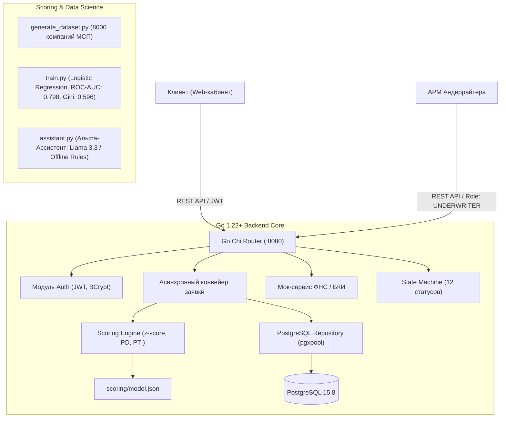

# Smart Credit Hub — Умный кредитный кабинет предпринимателя

Проект разработан в рамках хакатона **«Альфа-Будущее 2026»** для трека кредитования малого и микробизнеса (МСП).

Платформа решает ключевые проблемы кредитования малого бизнеса:
- **Мгновенное принятие решений** за секунды на основе автообогащения по ИНН (модели данных ФНС и БКИ).
- **Небинарные решения (Контр-оффер):** вместо сухого отказа банк предлагает сниженную посильную сумму и срок по нормативу долговой нагрузки ($PTI \le 35\%$).
- **«Серая зона» и АРМ Андеррайтера:** гибкий переход на ручное рассмотрение с запросом документов и витриной решений для кредитного инспектора.
- **Explainable AI (XAI) & Альфа-Ассистент:** расшифровка факторов риска на человеческом языке и интеллектуальный ИИ-консультант с открытыми LLM и автономным офлайн-фоллбэком.
- **Подписание и выдача:** симуляция подписания договора простой ЭП (ПЭП) и автоматического зачисления средств (`DISBURSED`).

---

## 🏛 Архитектура и стек технологий



### Основные компоненты:
* **Backend:** Go 1.22+, `github.com/go-chi/chi/v5`, `github.com/golang-jwt/jwt/v5`, `github.com/jackc/pgx/v5` (pgxpool), structured `log/slog`.
* **Database:** PostgreSQL 15.8 (автоматические миграции при старте через `embed.FS`).
* **Scoring & ML:** Python 3.11+, `scikit-learn`, `pandas`, `numpy`, `matplotlib` (калиброванная скоркарта, ROC-AUC: 0.798, Gini: 0.596).
* **Спецификация API:** OpenAPI 3.0.3 (`docs/openapi.yaml`).
* **Жизненный цикл заявки:** 12 состояний со строгой валидацией переходов (`docs/state-machine.md`).

---

## 👥 Демо-пользователи для проверки конвейера

В базу данных при старте автоматически зашиты 6 готовых профилей (`demo123` для всех):

| Логин | Пароль | Роль | ИНН | Компания | Ожидаемый исход конвейера |
| :--- | :---: | :---: | :---: | :--- | :--- |
| `client_alfa` | `demo123` | `CLIENT` | `7701000001` | ООО «Альфа Логистика» | 🟢 **Зеленая зона:** моментальное автоодобрение 3.0 млн ₽ под 18.5%. |
| `client_smirnov` | `demo123` | `CLIENT` | `7701000002` | ИП Смирнов Алексей Петрович | 🟡 **Желтая зона:** контр-оффер (3.25 млн ₽ по PTI $\le 35\%$). |
| `client_technostart`| `demo123` | `CLIENT` | `7701000003` | ООО «ТехноСтарт» | ⚪ **Серая зона:** передача в АРМ андеррайтера, запрос баланса. |
| `client_negativ` | `demo123` | `CLIENT` | `7701000004` | ООО «Негатив Трейд» | 🔴 **Красная зона:** отказ (стоп-фактор: просрочка в БКИ $\ge 90$ дней). |
| `client_megastroy` | `demo123` | `CLIENT` | `7701000005` | ООО «Мегастрой» | 🟢 **Превышение лимита:** контр-оффер на максимальный лимит продукта (10 млн ₽). |
| `underwriter` | `demo123` | `UNDERWRITER` | — | Главный Андеррайтер | Доступ к очереди `/api/v1/bank/applications` и принятию решений. |

---

## 🚀 Быстрый старт

### Вариант 1: Запуск всего окружения через Docker Compose (Рекомендуемый)

```bash
# Клонирование и переход в каталог проекта
git clone https://github.com/playblues/smart-credit-hub.git
cd smart-credit-hub

# Сборка и запуск контейнеров (PostgreSQL 15.8 + Go Backend)
docker compose up --build -d
```

Сервер станет доступен по адресу: `http://localhost:8080`  
Проверка состояния: `GET http://localhost:8080/healthz`

### Вариант 2: Локальный запуск (Go + локальный/контейнерный Postgres)

1. Запустите только базу данных:
   ```bash
   docker compose up -d postgres
   ```
2. Перейдите в каталог `backend` и запустите сервер:
   ```bash
   cd backend
   go run ./cmd/server
   ```
   Миграции схемы БД и тестовые пользователи накатятся автоматически.

---

## 🧪 Запуск тестов и верификация математики

### 1. Тестирование Go-бэкенда (100% покрытие ключевых модулей)
```bash
cd backend
go test -v -count=1 ./...
```
*Включает проверку авторизации, моков ФНС/БКИ, State Machine, персистентности, конвейера, загрузки файлов до 10 МБ, решений андеррайтера и всех 5 золотых кейсов скоринга.*

### 2. Тестирование эталонного скоринга на Python
```bash
python scoring/test_cases.py
# Результат: OK: 5 кейсов сошлись
```

### 3. Обучение скоринговой модели и валидация банковских метрик
```bash
pip install -r scoring/requirements.txt
python scoring/train.py
```
*Выводит матрицу ошибок, рассчитывает ROC-AUC и Gini, а также сохраняет визуализацию кривой в `docs/roc_auc_curve.png`.*

### 4. Тестирование умного AI-ассистента
```bash
python scoring/assistant.py
```

---

## 📡 Ключевые эндпоинты API (OpenAPI 3.0.3)

| Метод | Путь | Описание | Доступ |
| :---: | :--- | :--- | :---: |
| `POST` | `/api/v1/auth/login` | Аутентификация клиента / андеррайтера, выдача JWT | Публичный |
| `GET` | `/api/v1/mock/fns/{inn}` | Получение данных компании из симулятора ФНС | Публичный |
| `GET` | `/api/v1/mock/bki/{inn}` | Получение кредитной истории из симулятора БКИ | Публичный |
| `POST` | `/api/v1/applications` | Подача кредитной заявки и запуск конвейера | `CLIENT` |
| `GET` | `/api/v1/applications` | Список заявок текущего авторизованного клиента | `CLIENT` |
| `GET` | `/api/v1/applications/{id}` | Детали заявки со скорингом, аудит-логом и документами | `CLIENT` / `UNDERWRITER` |
| `POST` | `/api/v1/applications/{id}/counter-offer/accept` | Принятие встречного предложения банка | `CLIENT` |
| `POST` | `/api/v1/applications/{id}/counter-offer/reject` | Отклонение встречного предложения банка | `CLIENT` |
| `POST` | `/api/v1/applications/{id}/documents` | Загрузка документов (PDF, PNG, JPG до 10 МБ) в серой зоне | `CLIENT` |
| `POST` | `/api/v1/applications/{id}/sign` | Подписание кредитного договора кодом ПЭП и зачисление | `CLIENT` |
| `GET` | `/api/v1/bank/applications` | Очередь заявок андеррайтера (фильтры: `status`, `risk_zone`) | `UNDERWRITER` |
| `GET` | `/api/v1/bank/applications/{id}` | Детальная карточка заявки для кредитного инспектора | `UNDERWRITER` |
| `POST` | `/api/v1/bank/applications/{id}/decision` | Вынесение решения (`APPROVE`, `REJECT`, `REQUEST_DOCUMENTS`, `COUNTER_OFFER`) | `UNDERWRITER` |
| `GET` | `/healthz` | Проверка liveness сервиса и реального ping базы данных | Публичный |

Полная спецификация со всеми схемами DTO находится в [`docs/openapi.yaml`](docs/openapi.yaml).

---

## 📄 Документация и регламент хакатона

- [`docs/PRODUCT_RESEARCH.md`](docs/PRODUCT_RESEARCH.md) — Продуктовое исследование рынка МСП, User Personas, JTBD и MoSCoW-матрица (Слайды 4, 5, 8, 14, 15 ТЗ).
- [`docs/state-machine.md`](docs/state-machine.md) — Диаграмма состояний и матрица разрешенных переходов заявки.
- [`THIRD_PARTY_NOTICES.md`](THIRD_PARTY_NOTICES.md) — Перечень сторонних библиотек, описание синтетического датасета и смоделированных интеграций (Слайды 7, 10 ТЗ).
