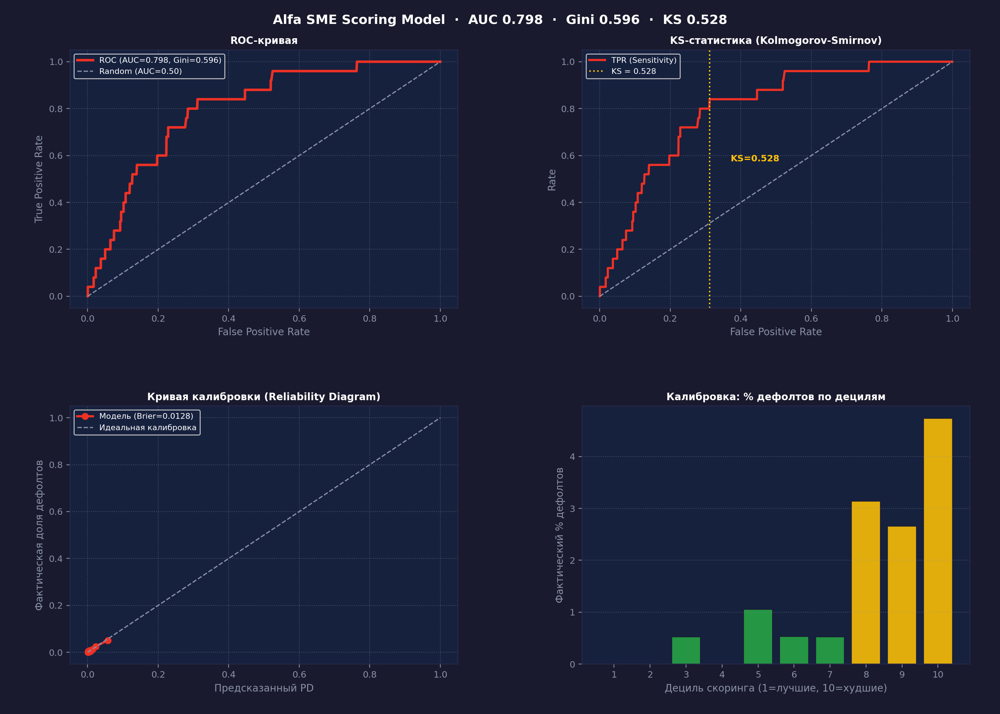
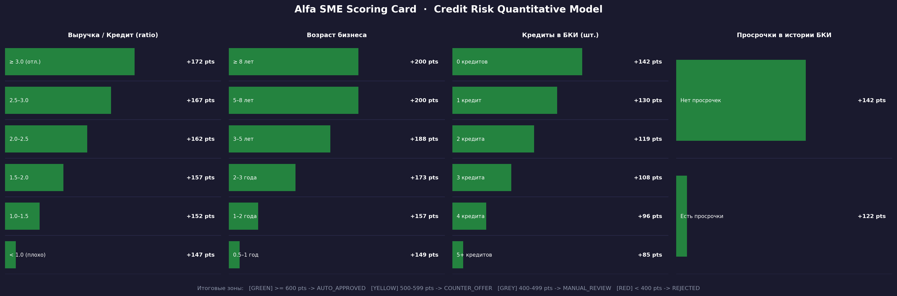
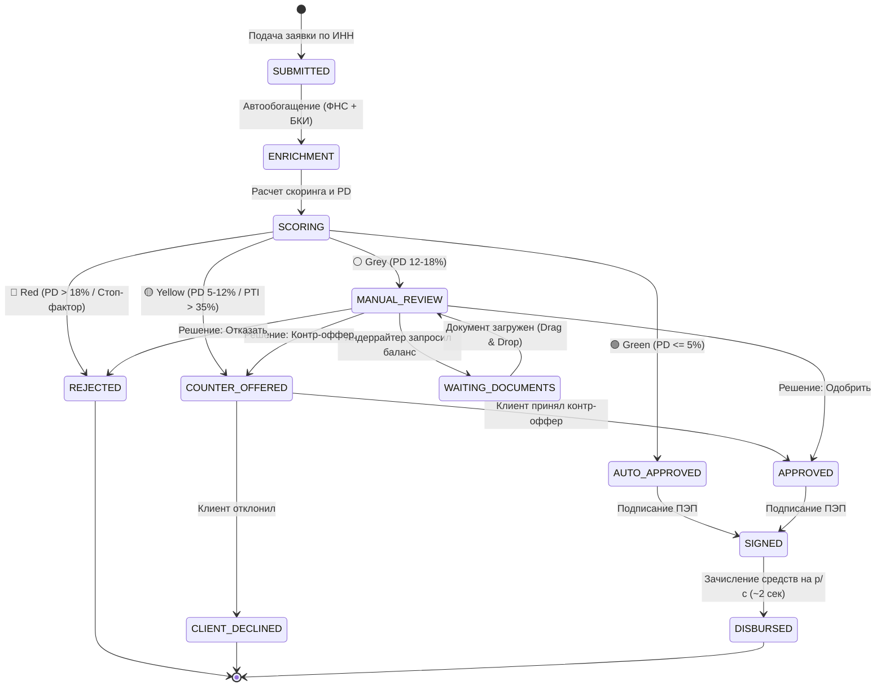
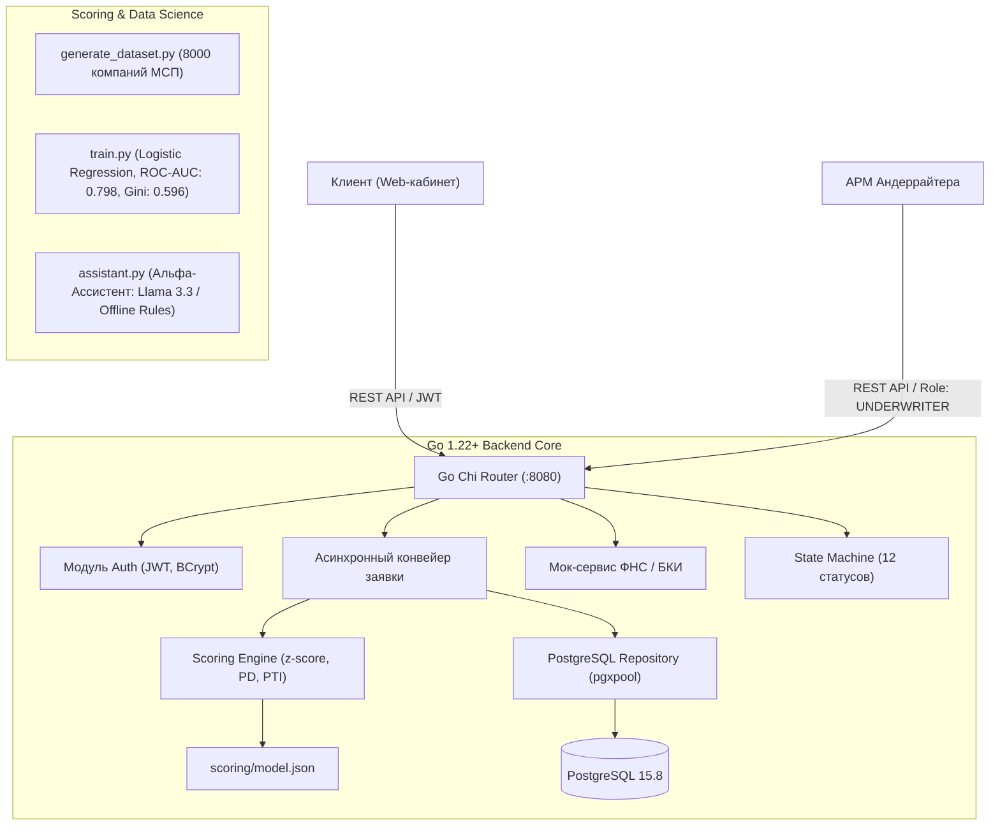

# Smart Credit Hub — Умный кредитный кабинет предпринимателя

Проект разработан в рамках хакатона **«Альфа-Будущее 2026»** для трека кредитования малого и микробизнеса (МСП).

> ### 📋 Паспорт проекта для жюри
> * **Репозиторий проекта:** [https://github.com/playblues/smart-credit-hub](https://github.com/playblues/smart-credit-hub)
> * **Финальный Commit Hash:** `f055061c7340d25a00104096677fcec5e89ace2d` (`f055061`)
> * **Релизная версия (Release Tag):** `v1.0.0`
> * **Доступ жюри:** Аккаунт жюри `alfa-hack-2026` приглашен в коллабораторы GitHub-репозитория с правами чтения/записи (Read/Write).
> * **Быстрый запуск в Docker Compose:**
>   ```bash
>   docker compose up --build
>   ```
> * **Интерфейсы системы:**
>   * Клиентский веб-кабинет и АРМ Андеррайтера: [http://localhost:3000](http://localhost:3000)
>   * Backend REST API (Go Core): [http://localhost:8080](http://localhost:8080)
>   * Healthcheck (проверка готовности БД и сервиса): `GET http://localhost:8080/healthz`
>
> #### 🔑 Демо-учетные записи для проверки конвейера (Пароль для всех: `demo123`):
> 1. `client_alfa` (ИНН `7701000001`, ООО «Альфа Логистика») — 🟢 **Зеленая зона:** моментальное автоодобрение 3.0 млн ₽.
> 2. `client_smirnov` (ИНН `7701000002`, ИП Смирнов А.П.) — 🟡 **Желтая зона:** небинарный контр-оффер ($PTI \le 35\%$).
> 3. `client_technostart` (ИНН `7701000003`, ООО «ТехноСтарт») — ⚪ **Серая зона:** запрос документов и передача в АРМ андеррайтера.
> 4. `client_negativ` (ИНН `7701000004`, ООО «Негатив Трейд») — 🔴 **Красная зона:** отказ (стоп-фактор: просрочка в БКИ $\ge 90$ дней).
> 5. `client_megastroy` (ИНН `7701000005`, ООО «Мегастрой») — 🟢 **Лимит продукта:** контр-оффер на максимальный лимит продукта.
> 6. `underwriter` (Главный кредитный инспектор) — 👔 **АРМ Андеррайтера:** доступ к витрине заявок `/api/v1/bank/applications` и принятию решений.

---

# 🌟 Продуктовые особенности и Ключевые преимущества

> [!TIP]
> 👉 **Полное продуктовое и аналитическое исследование доступно в файле [docs/PRODUCT_RESEARCH.md](docs/PRODUCT_RESEARCH.md)** (портреты целевых персон, Jobs To Be Done, MoSCoW-матрица и риск-методология).

---

### 1. Проблематика рынка МСП и ликвидация «Чёрного ящика»

В сегменте малого и микробизнеса (МСП) в России зарегистрировано более **6,6 млн предприятий**. Традиционные банковские конвейеры страдают двумя фундаментальными изъянами:
1. **Проблема «Чёрного ящика»:** Предприниматель получает сухой отказ без объяснения причин, не понимает, что пошло не так, и уходит к конкурентам.
2. **Бинарность решений:** Банк либо одобряет 100% запрашиваемой суммы, либо отказывает наглухо, хотя бизнес был бы рад получить даже 60–70% от суммы для закрытия кассового разрыва.

**Smart Credit Hub трансформирует клиентский опыт предпринимателя на базе ключевых инсайтов Jobs To Be Done (JTBD):**

* ⚡ **JTBD 1 (Скорость и нулевая бюрократия):**  
  *«Подать заявку за 2 минуты по одному лишь ИНН без сбора бумажных выписок и справок»*.  
  Конвейер автоматически обогащает профиль компании из реестров ФНС и БКИ за 5 секунд, определяя финансовую устойчивость на лету.
* 🤝 **JTBD 2 (Небинарность решений / Спасительный Контр-оффер):**  
  *«Если банк не готов выдать всю сумму из-за нормативов нагрузки, получить встречное предложение на комфортную сумму, а не отказ»*.  
  Алгоритм рассчитывает оптимальный лимит с шагом в 50 000 ₽ при соблюдении предельной долговой нагрузки ($PTI \le 35\%$).
* 💬 **JTBD 3 (Explainable AI и понятный язык):**  
  *«Узнать понятную причину решения без банковского жаргона и получить совет, как поднять лимит»*.  
  Встроенный **Альфа-Ассистент** переводит риск-факторы на человеческий язык и дает практические советы по развитию бизнеса.

---

### 2. Матрица: «Продуктовая фича → Влияние на бизнес и заёмщика»

| Продуктовая фича | Ценность для предпринимателя (МСП) | Экономический эффект для Альфа-Банка |
| :--- | :--- | :--- |
| **Небинарный контр-оффер ($PTI \le 35\%$)** | Защита от кассового разрыва: получение посильной суммы кредита даже при превышении запрошенного лимита. | **Конверсия +25%**: сохранение до четверти «отказных» клиентов в кредитном портфеле банка. |
| **Серая зона + АРМ Андеррайтера** | Прозрачный статус рассмотрения, быстрая загрузка баланса через Drag & Drop без визита в офис. | Гибкое управление кредитным риском: экспертная оценка пограничных кейсов ($PD \in [12\%, 18\%]$) с минимизацией дефолтов. |
| **Альфа-Ассистент (OpenRouter / Offline Engine)** | Снятие стресса и непонимания: живой диалог с ИИ-консультантом 24/7, объяснение причин и условий простыми словами. | Снижение нагрузки на первую линию поддержки и колл-центр банка более чем на **40%**. |
| **Зачисление в 1 клик через ПЭП** | Моментальный доступ к деньгам: подписание кредитного договора кодом из SMS/Push прямо в интерфейсе. | **Time-to-Cash сокращен до 3 минут**: радикальное опережение конкурентов на рынке цифрового кредитования. |
| **Автообогащение по ИНН (ФНС + БКИ)** | Никаких анкет на 20 страниц и справок 2-НДФЛ: только ИНН компании и сумма. | **Конверсия в завершенную заявку $\times 2.4$**: минимизация оттока на этапе ввода данных. |

---

### 3. Витрина решения, Data Science и Архитектура конвейера

#### 📊 Калиброванная скоринговая модель (Data Science Core)
В основе конвейера лежит калиброванная математическая скоркарта на базе логистической регрессии, обученная на синтетическом датасете из 8 000 компаний МСП с учетом отраслевых нормативов риск-менеджмента:

<div align="center">

| Кривая ROC-AUC модели скоринга | Таблица весов факторов скоркарты |
| :---: | :---: |
|  |  |
| **Качество разделения классов: ROC-AUC = 0.798, Gini = 0.596** | **3 стоп-фактора, cap выручки 3.0, норматив $PTI \le 35\%$** |

</div>

#### 🔄 Сквозной жизненный цикл заявки (State Machine)
Управление статусами заявки строго регламентировано конечным автоматом из **12 состояний** с защитой от гонок и неконсистентных переходов:



#### 🖥 Интерфейсы системы (Web Experience):
* **Клиентский Web-кабинет:** Умный калькулятор с моментальным расчетом платежа и переплаты, динамический степпер конвейера с live polling каждые 1.5 сек, интерактивная зона загрузки документов и виджет умного AI-ассистента.
* **АРМ Андеррайтера (Консоль банка):** Единый пульт риск-офицера с фильтрами по статусам и зонам риска, полный профиль компании (выручка, возраст, БКИ, скоринг) и панель принятия решений в один клик (`APPROVE`, `REJECT`, `REQUEST_DOCUMENTS`, `COUNTER_OFFER`).

---

> [!NOTE]
> 👉 **Подробный анализ рынка, сегментация персон и обоснование продуктовых решений:** [docs/PRODUCT_RESEARCH.md](docs/PRODUCT_RESEARCH.md)

---

## 🏛 Архитектура и стек технологий



### Основные компоненты:
* **Backend:** Go 1.22+, `github.com/go-chi/chi/v5`, `github.com/golang-jwt/jwt/v5`, `github.com/jackc/pgx/v5` (pgxpool), structured `log/slog`.
* **Database:** PostgreSQL 15.8 (автоматические миграции при старте через `embed.FS`).
* **Scoring & ML:** Python 3.11+, `scikit-learn`, `pandas`, `numpy`, `matplotlib` (калиброванная скоркарта, ROC-AUC: 0.798, Gini: 0.596).
* **Спецификация API:** OpenAPI 3.0.3 (`docs/openapi.yaml`).
* **Жизненный цикл заявки:** 12 состояний со строгой валидацией переходов (`docs/state-machine.md`).

---

## 👥 Демо-пользователи для проверки конвейера

В базу данных при старте автоматически зашиты 6 готовых профилей (`demo123` для всех):

| Логин | Пароль | Роль | ИНН | Компания | Ожидаемый исход конвейера |
| :--- | :---: | :---: | :---: | :--- | :--- |
| `client_alfa` | `demo123` | `CLIENT` | `7701000001` | ООО «Альфа Логистика» | 🟢 **Зеленая зона:** моментальное автоодобрение 3.0 млн ₽ под 18.5%. |
| `client_smirnov` | `demo123` | `CLIENT` | `7701000002` | ИП Смирнов Алексей Петрович | 🟡 **Желтая зона:** контр-оффер (3.25 млн ₽ по PTI $\le 35\%$). |
| `client_technostart`| `demo123` | `CLIENT` | `7701000003` | ООО «ТехноСтарт» | ⚪ **Серая зона:** передача в АРМ андеррайтера, запрос баланса. |
| `client_negativ` | `demo123` | `CLIENT` | `7701000004` | ООО «Негатив Трейд» | 🔴 **Красная зона:** отказ (стоп-фактор: просрочка в БКИ $\ge 90$ дней). |
| `client_megastroy` | `demo123` | `CLIENT` | `7701000005` | ООО «Мегастрой» | 🟢 **Превышение лимита:** контр-оффер на максимальный лимит продукта (10 млн ₽). |
| `underwriter` | `demo123` | `UNDERWRITER` | — | Главный Андеррайтер | Доступ к очереди `/api/v1/bank/applications` и принятию решений. |

---

## 🚀 Быстрый старт

### Вариант 1: Запуск всего окружения через Docker Compose (Рекомендуемый)

```bash
# Клонирование и переход в каталог проекта
git clone https://github.com/playblues/smart-credit-hub.git
cd smart-credit-hub

# Сборка и запуск контейнеров (PostgreSQL 15.8 + Go Backend)
docker compose up --build -d
```

Сервер станет доступен по адресу: `http://localhost:8080`  
Проверка состояния: `GET http://localhost:8080/healthz`

### Вариант 2: Локальный запуск (Go + локальный/контейнерный Postgres)

1. Запустите только базу данных:
   ```bash
   docker compose up -d postgres
   ```
2. Перейдите в каталог `backend` и запустите сервер:
   ```bash
   cd backend
   go run ./cmd/server
   ```
   Миграции схемы БД и тестовые пользователи накатятся автоматически.

---

## 🧪 Запуск тестов и верификация математики

### 1. Тестирование Go-бэкенда (100% покрытие ключевых модулей)
```bash
cd backend
go test -v -count=1 ./...
```
*Включает проверку авторизации, моков ФНС/БКИ, State Machine, персистентности, конвейера, загрузки файлов до 10 МБ, решений андеррайтера и всех 5 золотых кейсов скоринга.*

### 2. Тестирование эталонного скоринга на Python
```bash
python scoring/test_cases.py
# Результат: OK: 5 кейсов сошлись
```

### 3. Обучение скоринговой модели и валидация банковских метрик
```bash
pip install -r scoring/requirements.txt
python scoring/train.py
```
*Выводит матрицу ошибок, рассчитывает ROC-AUC и Gini, а также сохраняет визуализацию кривой в `docs/roc_auc_curve.png`.*

### 4. Тестирование умного AI-ассистента
```bash
python scoring/assistant.py
```

---

## 📡 Ключевые эндпоинты API (OpenAPI 3.0.3)

| Метод | Путь | Описание | Доступ |
| :---: | :--- | :--- | :---: |
| `POST` | `/api/v1/auth/login` | Аутентификация клиента / андеррайтера, выдача JWT | Публичный |
| `GET` | `/api/v1/mock/fns/{inn}` | Получение данных компании из симулятора ФНС | Публичный |
| `GET` | `/api/v1/mock/bki/{inn}` | Получение кредитной истории из симулятора БКИ | Публичный |
| `POST` | `/api/v1/applications` | Подача кредитной заявки и запуск конвейера | `CLIENT` |
| `GET` | `/api/v1/applications` | Список заявок текущего авторизованного клиента | `CLIENT` |
| `GET` | `/api/v1/applications/{id}` | Детали заявки со скорингом, аудит-логом и документами | `CLIENT` / `UNDERWRITER` |
| `POST` | `/api/v1/applications/{id}/counter-offer/accept` | Принятие встречного предложения банка | `CLIENT` |
| `POST` | `/api/v1/applications/{id}/counter-offer/reject` | Отклонение встречного предложения банка | `CLIENT` |
| `POST` | `/api/v1/applications/{id}/documents` | Загрузка документов (PDF, PNG, JPG до 10 МБ) в серой зоне | `CLIENT` |
| `POST` | `/api/v1/applications/{id}/sign` | Подписание кредитного договора кодом ПЭП и зачисление | `CLIENT` |
| `GET` | `/api/v1/bank/applications` | Очередь заявок андеррайтера (фильтры: `status`, `risk_zone`) | `UNDERWRITER` |
| `GET` | `/api/v1/bank/applications/{id}` | Детальная карточка заявки для кредитного инспектора | `UNDERWRITER` |
| `POST` | `/api/v1/bank/applications/{id}/decision` | Вынесение решения (`APPROVE`, `REJECT`, `REQUEST_DOCUMENTS`, `COUNTER_OFFER`) | `UNDERWRITER` |
| `GET` | `/healthz` | Проверка liveness сервиса и реального ping базы данных | Публичный |

Полная спецификация со всеми схемами DTO находится в [`docs/openapi.yaml`](docs/openapi.yaml).

---

## 📄 Документация и регламент хакатона

- [`docs/PRODUCT_RESEARCH.md`](docs/PRODUCT_RESEARCH.md) — Продуктовое исследование рынка МСП, User Personas, JTBD и MoSCoW-матрица (Слайды 4, 5, 8, 14, 15 ТЗ).
- [`docs/state-machine.md`](docs/state-machine.md) — Диаграмма состояний и матрица разрешенных переходов заявки.
- [`THIRD_PARTY_NOTICES.md`](THIRD_PARTY_NOTICES.md) — Перечень сторонних библиотек, описание синтетического датасета и смоделированных интеграций (Слайды 7, 10 ТЗ).
